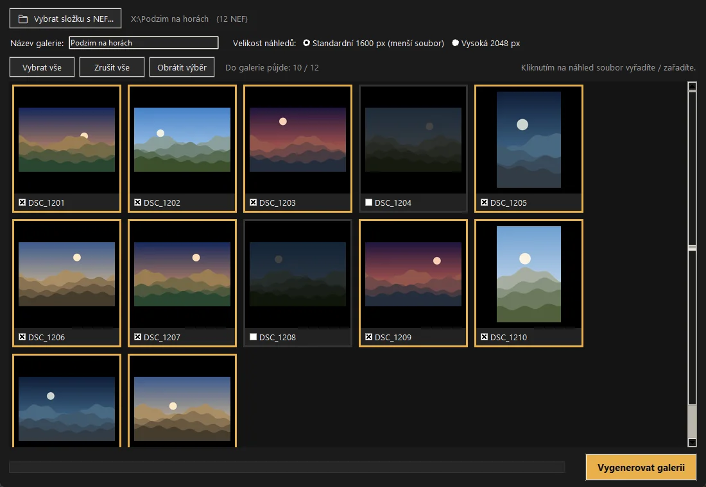
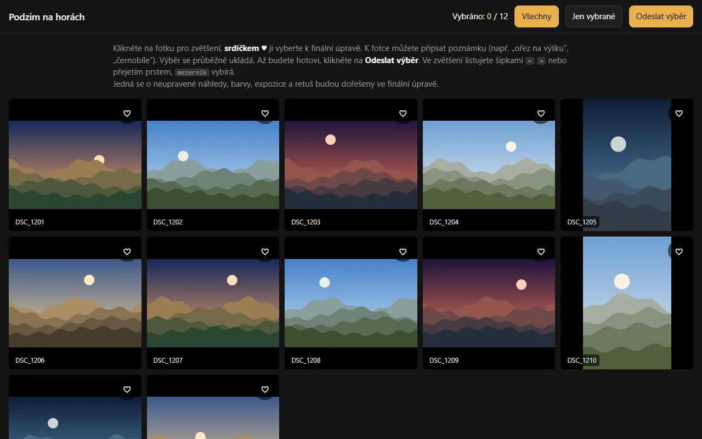
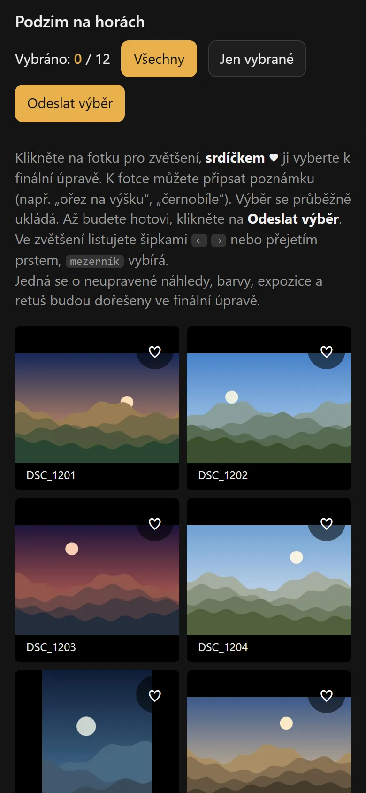

# NEF Galerie

Windows aplikace pro fotografy: z RAW souborů Nikon (NEF) vytvoří **jeden samostatný HTML soubor**, ve kterém si klient vybere fotky k finální úpravě. Soubor funguje na PC i na Androidu, bez rozbalování a bez instalace.



Vygenerovaná galerie, jak ji vidí klient (desktop a mobil):

 

*Screenshoty jsou z ukázkových dat: generované krajiny uložené jako testovací NEF soubory.*

## Co aplikace dělá
- Načte složku s NEF a zobrazí náhledy. Jednotlivé soubory lze vyřadit z galerie.
- Z NEFů vytáhne vložený JPEG náhled z fotoaparátu (RAW se nevyvolává) a otočí ho podle orientace.
- Každý náhled dostane číslo souboru a jemný vodoznak „NÁHLED“.
- Vytvoří `vybrat_fotky_k_editaci.html` s mřížkou, zvětšením (šipky nebo swipe), výběrem srdíčkem, poznámkami k fotkám a odesláním výběru e-mailem, sdílením, zkopírováním nebo jako .txt.
- Ve výběru je i řádek názvů souborů pro filtr v Lightroomu.

## Stack

Python · Tkinter (GUI) · Pillow · vlastní čtení náhledů z NEF (TIFF struktura, bez knihovny pro RAW) · výstup jako jeden HTML soubor s vloženými obrázky (base64) a vanilla JavaScriptem · PyInstaller (exe)

## Spuštění ze zdrojového kódu
```
pip install pillow
python nef_galerie.py
```

## Sestavení exe
```
pip install pyinstaller pillow
pyinstaller --noconfirm --onefile --windowed --name NEF_Galerie nef_galerie.py
```
Výsledek: `dist/NEF_Galerie.exe`

## Nastavení
E-mail fotografa a název výstupního souboru jsou konstanty `EMAIL` a `OUT_NAME` na začátku `nef_galerie.py`. Před sestavením exe nahraďte vzorový `vas@email.cz` svou adresou.

## Tip pro klienta (Android)
Soubor otevírejte v **Chrome**. Vestavěné HTML prohlížeče některých telefonů nespouštějí skripty.

## Jak vzniklo

Postaveno s Claude Code. Cíl: klient fotografa dostane jeden soubor, bez instalace si v něm vybere fotky a výběr pošle zpátky.

## Licence

[MIT](LICENSE) © 2026 Pavel Procházka
